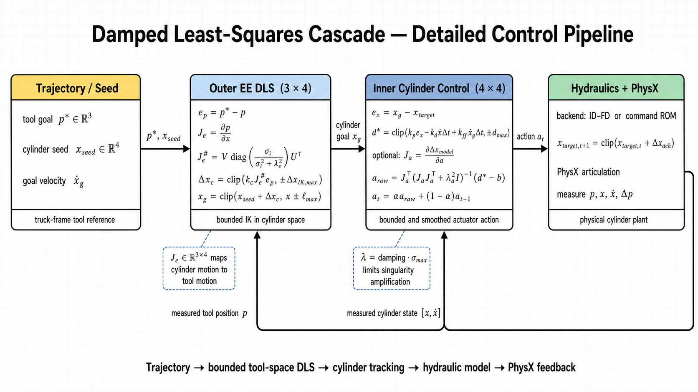

# Damped least-squares controller

This folder documents the damped least-squares (DLS) controller shared by
`PPO1_ID_FD_PhysX` and `PPO2_ROM_PhysX`. DLS is the geometric controller between a desired
mower-head trajectory and the hydraulic cylinder actuator. It converts a three-dimensional
tool goal into reachable four-cylinder targets, then converts cylinder tracking error into a
bounded and smoothed action for the selected hydraulic backend.

The maintained implementations remain in:

- [`PPO1_ID_FD_PhysX/dls_solver/`](../PPO1_ID_FD_PhysX/dls_solver/)
- [`PPO2_ROM_PhysX/dls_solver/`](../PPO2_ROM_PhysX/dls_solver/)

Those implementations are currently identical. This documentation folder deliberately does
not contain another source copy, which prevents the controller variants from silently
diverging.

## Detailed control pipeline



```text
tool trajectory p* and cylinder seed x_seed
                  |
                  v
       outer EE DLS / bounded IK (3 x 4)
                  |
             cylinder goal x_g
                  |
                  v
       inner cylinder controller (4 x 4)
                  |
          bounded smoothed action a_t
                  |
                  v
       ID-FD or ROM hydraulic backend -> PhysX
                  |
        measured p, x, xdot, hydraulic state
                  +---------------------------- feedback
```

The outer loop handles geometry. The inner loop handles cylinder tracking and actuator
conditioning. Hydraulic dynamics are supplied by ID-FD in PPO1 or by the command-conditioned
ROM in PPO2; DLS itself does not assume which learned backend is selected.

## Symbols

| Symbol | Meaning | Shape |
|---|---|---:|
| `p*` | desired mower-head position in the truck frame | 3 |
| `p` | measured mower-head position in the truck frame | 3 |
| `x_seed` | physics-mapped cylinder seed from the trajectory library | 4 |
| `x`, `xdot` | measured cylinder extension and velocity | 4 each |
| `x_g`, `xdot_g` | cylinder goal and goal velocity | 4 each |
| `J_e` | end-effector Jacobian, `d p / d x` | 3 x 4 |
| `J_a` | local learned actuator Jacobian, `d Delta x_model / d a` | 4 x 4 |
| `a_t` | normalized actuator action | 4 |
| `Delta t` | environment control step | scalar |

All cylinder quantities in these equations are in learned cylinder space, not joint space.
The end-effector quantities are expressed in the truck chassis frame; using the rotating arm
root frame would corrupt the slew contribution.

## 1. End-effector Jacobian

The controller maps cylinder motion to mower-head motion with

```math
\Delta p \approx J_e\,\Delta x, \qquad J_e \in \mathbb{R}^{3\times4}.
```

The reliable Jacobian is obtained by central finite differences while stepping PhysX so the
passive linkage constraints are solved:

```math
J_e[:,i] = \frac{p(x+\varepsilon e_i)-p(x-\varepsilon e_i)}{2\varepsilon}.
```

The controller computes `J_e = U diag(sigma) V^T` and uses the damped pseudoinverse

```math
J_e^{\#}
= V\,\operatorname{diag}\!\left(\frac{\sigma_i}{\sigma_i^2+\lambda_e^2}\right)U^T,
\qquad
\lambda_e = r_e\,\sigma_{max}.
```

Damping prevents excessive cylinder commands when the arm approaches a singular or poorly
conditioned pose. The small decomposition is deliberately performed on CPU because the project
has observed cuSOLVER abort Isaac Sim on ill-conditioned 3x4 and 4x4 batches.

## 2. Outer DLS: tool goal to cylinder goal

The active trajectory workflow supplies a verified physics-mapped cylinder seed. DLS adds only
a bounded measured-tool correction:

```math
e_p &= p^* - p, \\
\Delta x_c &= \operatorname{clip}(k_c J_e^{\#}e_p,
                                  -\Delta x_{IK,max},\Delta x_{IK,max}), \\
x_{req} &= \operatorname{clip}(x_{seed}+\Delta x_c,x_{min},x_{max}), \\
x_g &= \operatorname{clip}(x_{req},x-\ell_{max},x+\ell_{max}).
```

The last equation limits cylinder-reference lead, so a fast IK solution cannot request an
instantaneous jump that the hydraulic plant cannot follow. Cylinder 4 is then restored from the
trajectory seed because it owns mower-head pitch; cylinders 1-3 control position.

The general unseeded solver instead performs bounded Newton iterations in reference space:

```math
\Delta x_k &= \operatorname{clip}\!\left(k_{IK}J_e^{\#}(p^*-p_{ref,k}),
                                         -\Delta x_{IK,max},\Delta x_{IK,max}\right), \\
x_{ref,k+1} &= \operatorname{clip}(x_{ref,k}+\Delta x_k,x_{min},x_{max}), \\
p_{ref,k+1} &= p_{ref,k}+J_e\Delta x_k.
```

It periodically re-anchors the reference without re-running physics rollouts:

```math
p_{ref} \leftarrow p + J_e(x_{ref}-x).
```

Keeping the Newton loop in reference space avoids feeding measured plant lag and millimetre-scale
physics jitter directly back into the IK target.

## 3. Inner loop: cylinder error to desired motion

The inner controller first requests a per-control-step cylinder displacement:

```math
d^* = \operatorname{clip}\!\left(
      k_p e_x-k_d\dot{x}\Delta t+k_{ff}\dot{x}_g\Delta t,
      -d_{max},d_{max}\right).
```

For the active reference-anchored target integrator,

```math
e_x=x_g-x_{target}.
```

Closing this branch on the target prevents integrator wind-up while PhysX catches up. When the
learned reference blend is disabled, the alternate branch closes on measured error
`e_x=x_g-x`.

### Direct-target branch

The current fast controller uses `invert_learned_pipeline=False`. It converts the desired
cylinder increment into the environment's normalized action:

```math
a_{raw}=\operatorname{clip}\!\left(
\frac{S_{x\rightarrow q}\,d^*}{s_a},-a_{max},a_{max}\right),
```

where `S_(x->q)` converts learned cylinder displacement to the PhysX cylinder-coordinate
increment and `s_a` is the environment action scale.

### Optional learned-model inversion branch

When `invert_learned_pipeline=True`, the solver probes the selected ID-FD or ROM model around
zero action:

```math
J_a[:,i] &= \frac{F(+\varepsilon_a e_i)-F(-\varepsilon_a e_i)}{2\varepsilon_a}, \\
b &= \frac{1}{8}\sum_{i=1}^{4}\left[F(+\varepsilon_a e_i)+F(-\varepsilon_a e_i)\right].
```

With `lambda_a = r_a sigma_max(J_a)`, it solves

```math
a_{raw}=J_a^T(J_aJ_a^T+\lambda_a^2I)^{-1}(d^*-b).
```

This is the damped least-squares minimum-norm action. It remains bounded even when the learned
local action-to-cylinder map is nearly singular.

Both branches finish with action saturation and exponential smoothing:

```math
a_t=\alpha a_{raw}+(1-\alpha)a_{t-1},
\qquad |a_t|\le a_{max}.
```

## 4. Hydraulic backend and feedback

The smoothed four-axis action is interpreted by the active cylinder backend:

- PPO1: inverse dynamics -> valve command -> forward dynamics -> achievable cylinder increment.
- PPO2: desired cylinder command -> one command-conditioned hydraulic ROM -> achievable
  cylinder increment.

The resulting bounded cylinder target is integrated and applied to the PhysX articulation.
PhysX supplies measured `p`, `x`, and `xdot`; the hydraulic runtime additionally maintains
pressure difference, force, valve, and recurrent history as required by its model. These
measurements close the outer and inner loops on the physical state.

## Active PPO1 residual-policy settings

| Setting | Value |
|---|---:|
| End-effector Jacobian | fixed measured 3x4 ground Jacobian |
| Cylinder-4 Jacobian column | zeroed; cylinder 4 reserved for head pitch |
| Tool correction gain `k_c` | 0.05 |
| Maximum IK correction per iteration | 0.004 m |
| Maximum cylinder-reference lead | 0.025 m |
| Cylinder error gain `k_p` | 0.18 |
| Velocity damping `k_d` | 0.0 s |
| Velocity feedforward `k_ff` | 1.0 |
| Maximum desired cylinder increment | 0.004 m/control step |
| Maximum normalized action | 1.0 |
| New-action smoothing weight `alpha` | 0.10 |
| Learned-pipeline inversion | disabled in the active fast path |

These are task-level settings, not universal DLS constants. PPO2-ROM gates may use different
tool-correction gains while reusing the same solver.

## Why damping and bounds are necessary

- A plain pseudoinverse amplifies noise near singular poses; damping limits this amplification.
- Closing a target integrator only on measured position can overshoot because the target keeps
  advancing while the plant is still catching up.
- Sending measured tool jitter directly through IK moves the cylinder reference itself; the
  reference-space Newton loop and seed map avoid that failure mode.
- Limiting IK step, cylinder lead, desired displacement, action magnitude, and action rate keeps
  the cascade hydraulically achievable and prevents oscillation.

## Validation commands

Run from the repository root:

```bash
# PPO1: learned-pipeline rank and four-cylinder step/return behavior
/home/rrlab/miniconda3/envs/env_isaaclab/bin/python \
  PPO1_ID_FD_PhysX/tests/rank_gate.py --headless --num_envs 1

/home/rrlab/miniconda3/envs/env_isaaclab/bin/python \
  PPO1_ID_FD_PhysX/dls_solver/tests/idfd_step_gate.py --headless

# PPO1: complete fast/smooth end-effector trajectory gate
/home/rrlab/miniconda3/envs/env_isaaclab/bin/python \
  PPO1_ID_FD_PhysX/dls_solver/tests/ground_arc_tracking_gate.py \
  --headless --speed_mps 0.18 --cycles 1

# PPO2: ROM-to-PhysX four-cylinder gate
/home/rrlab/miniconda3/envs/env_isaaclab/bin/python \
  PPO2_ROM_PhysX/dls_solver/tests/rom_step_gate.py \
  --headless --goal_delta_m 0.035 --steps 600 --tolerance_m 0.01 \
  --backend rom --dynamics_model command_rom --hydraulic_mode fd_dp_state

# PPO2: complete ROM end-effector trajectory gate
/home/rrlab/miniconda3/envs/env_isaaclab/bin/python \
  PPO2_ROM_PhysX/dls_solver/tests/ground_arc_tracking_gate.py \
  --headless --speed_mps 0.18 --cycles 1
```

The GUI version of either ground-arc command is obtained by removing `--headless` and adding
`--realtime`.
