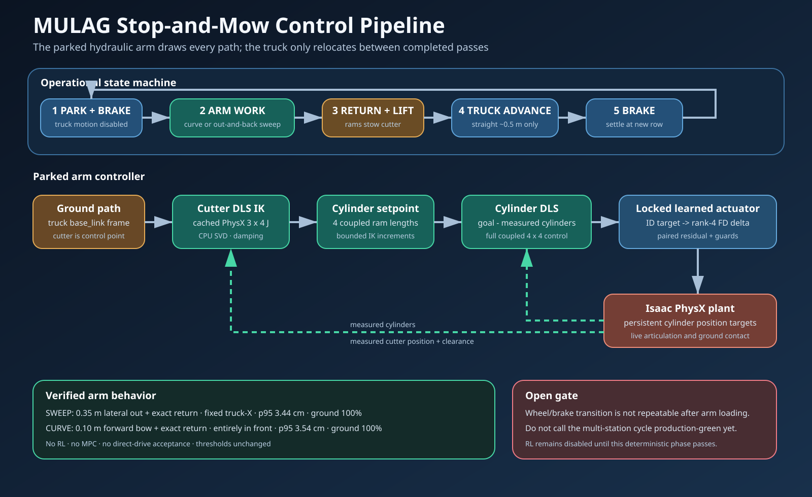

# MULAG learned-hydraulic control pipeline

This folder is the maintained ID/FD arm-control stack. The next baseline is deliberately
**arm only**: disable the truck, make the hydraulic rams execute a long accumulated
ground-mowing cycle, and keep the mower head facing down throughout. Truck relocation is
deferred until the arm and PPO residual controller are independently reliable.



## Current engineering status

- FD/ID rank gate: rank 4/4 throughout the learned actuator pipeline.
- Cylinder DLS: measured-state feedback through the locked learned ID/FD models.
- EE IK: cached physics-measured 3x4 cutter Jacobian and CPU damped least squares.
- Parked sweep: **PASS**. The arm makes a true lateral out-and-back stroke; truck-frame
  X is constant, ground contact is 100%, and p95 tracking error is 3.44 cm.
- Parked bowed curve: **PASS**. The arm makes a closed curve with a 0.10 m forward bow;
  every reference point remains in front of the truck, ground contact is 100%, and p95
  tracking error is 3.54 cm.
- Combined park/work/advance/repeat: **not yet repeatably green**. One complete sweep
  run passed, but subsequent runs exposed a non-repeatable wheel/brake transition that
  can produce lateral truck motion after arm loading. This is not hidden or waived.
- RL (`ppo1/`): task IMPLEMENTED and contract-verified (2026-07-13), training smoke
  saves checkpoints. Action = (dy, dz) residual on the mapped-arc goal + a truck-speed
  command (teacher_student-style direct wheel write). Zero action == the parked-truck
  deterministic controller exactly (asserted by `ppo1/tests/zero_action_contract.py`).
  Adoption still requires the deterministic policy to BEAT the zero-action baseline.
- Long arm-only mowing cycle: **PASS**. The full three-lobe sine sweep produced
  12.485 m reference travel and 14.507 m measured cutter travel against the 7 m
  minimum, p95 error 4.28 cm, ground contact 100%, and truck drift 2 mm.
- Head-down constraint: **PASS**. Position DLS uses cylinders 1-3 (rank 3,
  condition 3.85); cylinder 4 is held at the calibrated ground reference. Its measured
  travel was 0.3 mm and minimum downward alignment was 0.973.
- Maximum unique spatial reach, measured with the unchanged gate: **1.00 m centred
  line** and **0.80 m semicircle/sine lateral span**. These are metres, not centimetres.
  The separate 7 m setting is accumulated cutter travel over repeated full spans.

## Next trajectory architecture

The arm cannot create metres of unique spatial reach inside a roughly half-metre local
workspace. A meaningful **long** arm-only trajectory therefore means a multi-metre
accumulated mowing cycle made from repeated full-width strokes, not a shortened marker
or an unreachable straight line.

The proposed deterministic reference is:

1. Truck motion disabled for the entire episode.
2. Use the largest physics-verified ground-level lateral swath.
3. Traverse it repeatedly with a smooth periodic/S-curve time law. Avoid instantaneous
   direction reversals and disconnected waypoints.
4. Require at least 3-5 m accumulated cutter travel, a clearly visible spatial span,
   real cylinder travel, and continuous ground contact.
5. Treat cutter position as the primary task and downward mower-head pitch as a required
   secondary task.

Cylinder 4 is no longer consumed freely by position IK. The measured position Jacobian
for cylinders 1-3 remains full rank, so the implemented simple solution is:

```text
primary:   cylinders 1-3 move the cutter through the ground reference
secondary: cylinder 4 holds the calibrated downward-facing head reference
```

The gate also measures the head's authored local `+Z` mowing-face axis against world
down and requires alignment >=0.90, cylinder-4 travel <1 cm, ground contact >=90%, and
the unchanged 5 cm tracking limit.

The PPO1 policy sits above this controller (implemented in `ppo1/env.py`). Its action is
limited to small
tracking, height/pitch, and speed corrections. Zero policy action must reproduce the
deterministic long-cycle baseline. PPO may improve smoothness, hydraulic lag, turnaround
speed, and residual error; it must not learn raw cylinder control or compensate for an
unreachable path.

Exact measurements and rejected experiments are in
[the stop-and-mow report](docs/stop_and_mow_report.md).

## Why DLS is used

Damped least squares is the smallest proven controller that fits this plant. The cutter
Jacobian is rectangular and coupled; DLS handles that directly, remains stable near
weak directions, and is the same differential-IK pattern used in IsaacLab examples.
An operational-space torque controller does not match this learned hydraulic
position-target interface, and MPC is intentionally not used.

The live loop is:

1. Ground path provides a cutter goal in truck `base_link` coordinates.
2. Cached physics-measured Jacobian maps cutter error to four cylinder setpoints by DLS.
3. Cylinder DLS closes on measured cylinder positions.
4. Locked ID and rank-4 FD models produce bounded target increments.
5. PhysX advances the arm; live cutter and cylinder feedback close both loops.

The control point is the cutter, not the `Messerkopf` body origin. Do not use
`write_joint_state_to_sim` as FK, analytic articulation-Jacobian column slices, or a
single frozen linear workspace map.

## Folder map

```text
ID_FD_pipline/
├── dls_solver/                deterministic lower-level controller
│   ├── cylinder.py            measured-cylinder DLS controller
│   ├── ee_cascade.py          cutter-space DLS cascade
│   ├── ground_paths.py        mapped ground path helpers
│   ├── kinematics.py          stepped-PhysX Jacobian measurement
│   └── tests/                 controller, trajectory, and stop/mow gates
├── models/                    locked checkpoints and cached maps/Jacobians
│   ├── fd/
│   └── id/
├── ppo1/                      isolated upper-level PPO; currently disabled
├── tasks/                     IsaacLab environment and runtime configuration
├── mdp/                       shared action/observation/reward contracts
├── scripts/                   reproducible model-training utilities
├── tests/                     deterministic rank gate
└── docs/                      diagram, investigation history, engineering report

plant_study/                   direct-plant and workspace diagnostics
```

## Setup

Run from the repository root:

```bash
cd ~/rrlab_mulag
source ~/miniconda3/etc/profile.d/conda.sh
conda activate env_isaaclab
```

If the wrapper reports a terminal capability error, prefix the command with
`TERM=xterm`.

## Run the robot

### Long arm-only trajectories (recommended PPO baselines)

```bash
# Maximum 1.00 m centred line; truck disabled
TERM=xterm ./rrlab.sh -p ID_FD_pipline/dls_solver/tests/stop_and_mow_gate.py \
  --shape line --long_path_m 7.0 --headless

# Maximum accepted 0.80 m lateral semicircle; truck disabled
TERM=xterm ./rrlab.sh -p ID_FD_pipline/dls_solver/tests/stop_and_mow_gate.py \
  --shape semicircle --long_path_m 7.0 --headless

# Maximum accepted 0.80 m lateral three-lobe sine sweep
TERM=xterm ./rrlab.sh -p ID_FD_pipline/dls_solver/tests/stop_and_mow_gate.py \
  --shape sweep --long_path_m 7.0 --headless

# Watch any shape: green path, red goal, blue cutter
TERM=xterm ./rrlab.sh -p ID_FD_pipline/dls_solver/tests/stop_and_mow_gate.py \
  --shape sweep --long_path_m 7.0 --realtime
```

All references use cosine turnarounds, so commanded velocity reaches zero smoothly at
both ends. `line` spans 1.00 m centred on the settled anchor, `semicircle` uses a 0.80 m
lateral span with a 0.18 m forward bow, and `sweep` uses a 0.80 m lateral span with three
0.06 m sine lobes. Arm-only mode is the default; the truck remains disabled throughout.

The maximum search was physical and gate-driven: centred line 1.00 m passed at p95
4.56 cm; 1.10 m failed at 5.19 cm, 1.20 m failed at 6.21 cm, and 1.40 m diverged.
The coarse map's 3.78 x 2.75 m bounding box is not a continuous reachable path and must
not be presented as one. The reproducible map branch spans about 1.49 m laterally, but
only the 1.00 m centred subset closes and tracks under the learned actuator.

### Residual PPO (ppo1)

The nominal reference is the physics-mapped ground arc; the same calibrated cascade
executes it. The policy adds a small (dy, dz) goal correction (max 0.05 m) and commands
the truck speed (0 = parked; wheels are driven by a direct velocity write, so the truck
only moves when the policy asks).

Reward: `-20 * ||goal - cutter||_3D + 1.5 * (error < 0.05 m) * truck_kmh / 6` —
full 3-D tracking error (primary) plus a driving-progress bonus that ONLY pays while
tracking is good, so "drive fast, ignore the arm" loses. No motion/action penalties
(they caused the historical hold-still collapse).

```bash
# zero-action equivalence contract (must PASS before/after any ppo1 change)
TERM=xterm ./rrlab.sh -p ID_FD_pipline/ppo1/tests/zero_action_contract.py --num_envs 2 --headless

# deterministic zero-action controller baseline on the mapped arc
TERM=xterm ./rrlab.sh -p ID_FD_pipline/ppo1/tests/controller_baseline.py --num_envs 1 --headless

# train (note: this runner prints NO iteration banners; check
# logs/rsl_rl/id_fd_ee_yz_residual/<stamp>/model_*.pt for progress)
TERM=xterm ./rrlab.sh -p ID_FD_pipline/ppo1/scripts/train.py --num_envs 16 --max_iterations 300 --headless

# acceptance: deterministic policy must beat the zero-action floor on the same arc
# (floor verified 2026-07-13: 2.4 cm mean / 3.4 cm p95 after porting the gate's
#  direct pre-position + settle->mow handoff into the env)
TERM=xterm ./rrlab.sh -p ID_FD_pipline/ppo1/scripts/evaluate.py --headless

# watch a checkpoint (omit --headless); --controller_only for the zero-action baseline
TERM=xterm ./rrlab.sh -p ID_FD_pipline/ppo1/scripts/play.py
```

### Headless diagnostics

```bash
# Locked learned-pipeline rank gate
TERM=xterm ./rrlab.sh -p ID_FD_pipline/tests/rank_gate.py --num_envs 1 --headless

# Four independent 8 cm cylinder steps through ID/FD
TERM=xterm ./rrlab.sh -p ID_FD_pipline/dls_solver/tests/idfd_step_gate.py \
  --model_mode paired --residual_gains 20,10,2,2 --headless

```

### Offline artifacts

Rebuild only if geometry, cylinder limits, or the cutter point changes:

```bash
TERM=xterm ./rrlab.sh -p plant_study/map_ground_band.py --headless
TERM=xterm ./rrlab.sh -p plant_study/measure_ground_ee_jacobian.py --headless
```

## Locked invariants

- Active ID: `models/id/best_id_cylinder_control.pt`.
- Active FD: `models/fd/best_fd_cylinder_control.pt`.
- Do not retrain either checkpoint during controller/vehicle work.
- Truck `base_link` is the path frame; the cutter is the controlled point.
- Keep paired ID/FD residualization and measured cylinder feedback.
- Keep small SVD operations on CPU.
- The truck is stationary during every scored arm path.
- For the next baseline, scripted truck motion stays disabled for the whole episode.
- The mower head must face down; cylinder 4 is reserved/prioritized for this objective
  after its pitch authority is measured.
- A sweep must go out and back. A curve must stay in front of the truck.
- Do not reduce path length or acceptance thresholds to obtain a green result.
- Do not enable RL until zero residual reproduces the deterministic controller and a
  deterministic policy improves it.

Dead ends are recorded in [`memory.md`](../memory.md) so they are not repeated.
