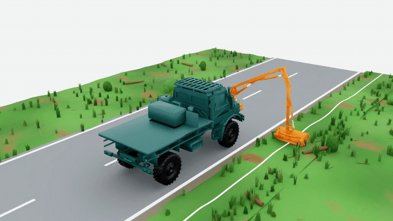
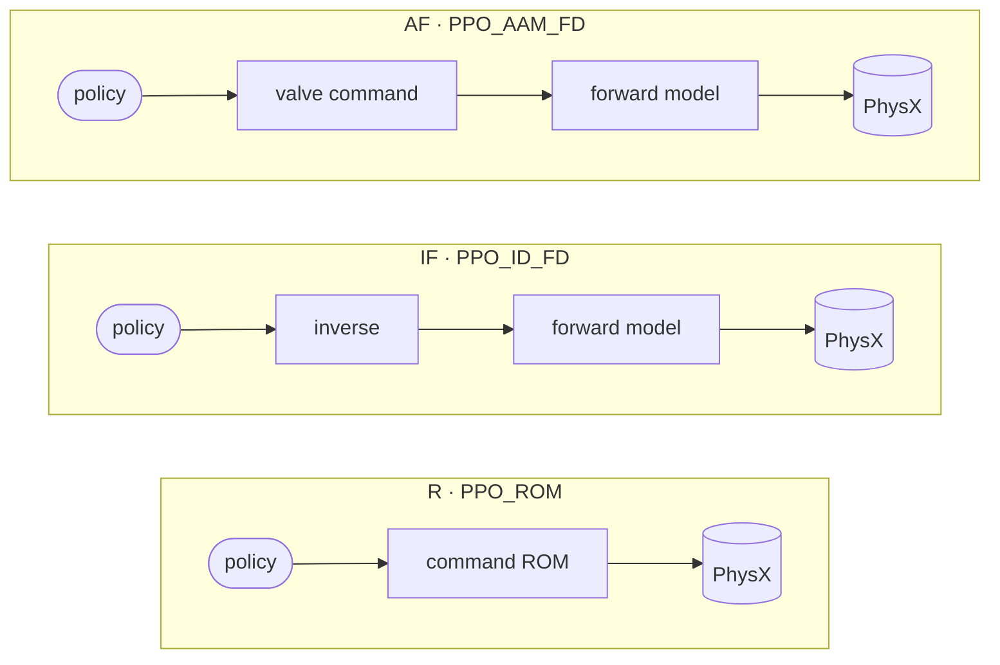

<div align="center">

# MULAG verge mower — learned hydraulics and online adaptation

**Learning-Based Online Adaptation for Control of a Hydraulic Manipulator**<br>
Master Thesis · Kevin Kudakwashe Murera<br>
Robotics Research Lab · Department of Computer Science · University of Kaiserslautern-Landau · 2026

<br>



<br><br>

<a href="docs/Kevin_Kudakwashe_Murera_Masterarbeit.pdf"></a>
&nbsp;
<a href="docs/Kevin_Kudakwashe_Murera_Masterarbeit_Presentation.pptx"></a>


[Overview](#overview) · [Documents](#documents) · [Setup](#setup) · [The three stacks](#the-three-stacks) · [Run](#run) · [Layout](#layout) · [Citation](#citation)

</div>

---

## Overview

A MULAG FME 500 verge mower on a Unimog carrier. The truck drives the road at a
constant speed; the arm reaches over the embankment and the cutter follows a line
along the verge. **Tracking is the objective, terrain is the disturbance.**

Reinforcement-learning pipelines, the learned actuator models they act through,
the experiments, and the thesis that reports them.

> [!NOTE]
> All evidence is simulation-to-simulation; nothing here is a claim about hardware.

## Documents

| | Document | What it is |
|:-:|---|---|
| 📄 | [**Thesis** (PDF, 130 pages)](docs/Kevin_Kudakwashe_Murera_Masterarbeit.pdf) | *Learning-Based Online Adaptation for Control of a Hydraulic Manipulator* — the full write-up |
| 📊 | [**Presentation** (PPTX)](docs/Kevin_Kudakwashe_Murera_Masterarbeit_Presentation.pptx) | The thesis slides, including the demo videos *IF vs R*, *AP frozen* and *AP adaptive* |
| 🎞️ | [**Simulation clip** (GIF)](docs/assets/mulag_simulation.gif) | The animation at the top of this page, taken from the slides |

## Setup

```bash
PY=~/miniconda3/envs/env_isaaclab/bin/python
```

> [!WARNING]
> Pinned, do not upgrade: `torch==2.7.0`, `numpy==1.26.0`, `rsl-rl-lib==5.0.1`.<br>
> Import RSL-RL config classes from `rrlab_compat.rsl_rl`, never `isaaclab_rl`.

## The three stacks

| | stack | command path |
|:-:|---|---|
| **R** | [PPO_ROM](PPO_ROM/README.md) | policy → command ROM → PhysX |
| **IF** | [PPO_ID_FD](PPO_ID_FD/README.md) | policy → inverse → forward model → PhysX |
| **AF** | [PPO_AAM_FD](PPO_AAM_FD/README.md) | policy → valve command → forward model → PhysX |



R and IF differ only in the actuator path. AF emits the valve command instead of
a cylinder increment, so it is not scored against them.

> [!TIP]
> **Each pipeline README holds that stack's full commands, including training.**

## Run

```bash
cd ~/rrlab_mulag
```

**Watch a shipped policy**

```bash
PPO_ROM/visualize.sh logs/rsl_rl/ppo3_1_sole/speed_range_2_7_pathfix_v2_rom/model_promoted_2_7kmh.pt \
  --unimog_speed 7 --trajectory-shape double_s_curve --num-envs 4 --mesh 17 --steps 2808
```

**Preflight before spending GPU hours**

```bash
$PY PPO_ROM/scripts/preflight.py --num_envs 32 --steps 120
```

**Score on the eight gates, one process per mesh**

```bash
MESHES="1337 17 909" PPO_ROM/scripts/score_per_mesh.sh <name> <ckpt.pt> 2808 32
```

## Layout

| Folder | What it holds |
|---|---|
| [`PPO_ROM/`](PPO_ROM/) [`PPO_ID_FD/`](PPO_ID_FD/) [`PPO_AAM_FD/`](PPO_AAM_FD/) | the three stacks |
| [`verge_task/`](verge_task/) [`mulag_plant/`](mulag_plant/) | terrain, environment, DLS teacher |
| [`rrlab_compat/`](rrlab_compat/) | RSL-RL config classes |
| [`learned_models/`](learned_models/) | the learned actuator models |
| &emsp;↳ [`rom_model/`](learned_models/rom_model/) | command ROM → PPO_ROM |
| &emsp;↳ [`id_fd_model/`](learned_models/id_fd_model/) | inverse + forward → PPO_ID_FD, PPO_AAM_FD |
| &emsp;↳ [`sd_model/`](learned_models/sd_model/) | state dynamics. Not in the thesis. |
| [`experiments/`](experiments/) | one folder per Chapter 7 section |
| [`reports/`](reports/) [`outputs/`](outputs/) | pre-registrations, scored reports |
| [`AAM_module/`](AAM_module/) | datasets; results use the `_frozen` copies |
| [`logs/rsl_rl/`](logs/rsl_rl/) | runs and checkpoints |
| [`docs/`](docs/) | the thesis PDF, the presentation, and this page's media |
| [`archive/`](archive/) | retired material |

Read a folder's own README before touching it.

> [!IMPORTANT]
> **`archive/` is load-bearing**, despite the name: the Chapter 4/5/6 figure
> scripts read `model_training_trees/` and `ppo_rom_retired_2026-08-16/`, and
> `ppo_rom_stage6_tools/` is executed by `rebuild_rom_idfd_stage6.sh`. Grep before
> deleting anything there.

## Citation

```bibtex
@mastersthesis{murera2026online,
  author = {Kevin Kudakwashe Murera},
  title  = {Learning-Based Online Adaptation for Control of a Hydraulic Manipulator},
  school = {Robotics Research Lab, Department of Computer Science, University of Kaiserslautern-Landau},
  year   = {2026},
  type   = {Master Thesis}
}
```
