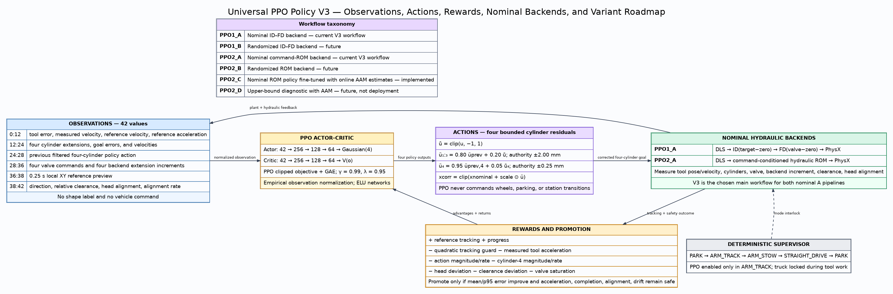

# Universal PPO Policy V3

The universal PPO policy is the shared command-conditioned tracking contract used by
the two chosen nominal V3 workflows:

1. **PPO1_A** — nominal ID/FD hydraulic backend.
2. **PPO2_A** — nominal command-conditioned hydraulic ROM backend.

“A” means nominal plant/model parameters. The policy structure is shared, but each
backend has its own trained checkpoint because its hydraulic feedback distribution is
different.



## Workflow naming roadmap

| Name | Meaning | Status |
|---|---|---|
| PPO1_A | Nominal ID/FD backend | Current V3 main workflow; selected `model_575.pt` |
| PPO1_B | Randomized ID/FD backend | Future robustness workflow |
| PPO2_A | Nominal ROM backend | Current V3 main workflow; selected `model_607.pt` |
| PPO2_B | Randomized ROM backend | Future robustness workflow |
| PPO2_C | Nominal ROM policy fine-tuned with online AAM latent variables | Implemented; promotion pending |
| PPO2_D | Upper-bound diagnostic with AAM information | Future diagnostic only, not deployment |

PPO2_D is explicitly an upper-bound experiment: it measures what could be achieved
with privileged/diagnostic AAM information and must not be presented as the deployable
controller.

## Observations

PPO1_A and PPO2_A receive 42 values:

| Slice | Signal |
|---:|---|
| 0:3 | reference minus measured tool position |
| 3:6 | measured tool velocity |
| 6:9 | reference tool velocity |
| 9:12 | reference tool acceleration |
| 12:16 | four measured cylinder extensions |
| 16:20 | four corrected-goal errors |
| 20:24 | four measured cylinder velocities |
| 24:28 | previous filtered four-cylinder policy action |
| 28:32 | hydraulic valve command |
| 32:36 | backend extension increment: FD response or ROM increment |
| 36:38 | 0.25 s local XY reference preview |
| 38 | A→B/B→A direction |
| 39 | reference-relative tool clearance |
| 40 | head-down alignment |
| 41 | head-alignment rate |

There is no shape label, template phase, wheel state command, or station identifier.
Local reference dynamics and measured plant response make the policy trajectory-
conditioned rather than shape-name-conditioned.

PPO2_C appends seven causal online AAM estimates to this unchanged base vector:
`e_comp`, `e_flow`, `e_pressure`, and four seal factors. Its observation dimension is
therefore 49. Hidden ROM randomization parameters are not policy observations; using
them directly is reserved for the PPO2_D diagnostic.

## Actions

The actor produces four normalized cylinder residuals:

```text
cylinders 1–3: EMA β = 0.80, authority ±2.00 mm
cylinder 4:    EMA β = 0.95, authority ±0.25 mm
```

The filtered residual is added to the reachable nominal cylinder goal and clamped to
the learned cylinder range. The deterministic supervisor, not PPO, owns parking,
wheels, straight relocation, and station transitions.

## Rewards

The reward is evaluated against the original unmodified tool reference:

```text
+ reference tracking
+ error progress
− quadratic tracking guard
− measured tool acceleration
− action magnitude and action rate
− cylinder-4 magnitude and rate
− head-alignment deviation
− clearance deviation
− valve saturation
```

Promotion uses paired per-environment evaluation and requires improved mean and p95
tracking without unsafe acceleration regression, shape regression, incomplete paths,
head misalignment, or retained truck drift.

## Controller and plant loop

```text
reference -> nominal cylinder seed -> PPO correction -> corrected cylinder goal

PPO1_A: corrected goal -> DLS -> ID -> FD -> PhysX
PPO2_A: corrected goal -> DLS -> command ROM -> PhysX
PPO2_C: corrected goal -> DLS -> factor-conditioned command ROM -> PhysX
        measured 10x20 history -> online AAM -> seven policy estimates
```

Measured tool, cylinder, hydraulic, clearance, and alignment signals close the policy
observation loop. PPO does not replace DLS, the hydraulic model, PhysX, or the
park/work supervisor.

## What `mdp/` means

MDP means **Markov Decision Process**. In these pipelines, `mdp/` contains internal
task utilities used by Isaac Lab: action sanitization, development-task observations
and rewards, and pipeline summaries. It is not the deployed PPO actor-critic package.

The deployed actor-critic and its Python package are both named **Policy** (`policy/`).
Checkpoint filenames and historical log directories retain their original experiment
names so trained artifacts remain traceable.

## Current V3 commands

```bash
# PPO1_A — nominal ID/FD V3
cd /home/rrlab/rrlab_mulag
./PPO1_ID_FD_PhysX/train_v3.sh
```

```bash
# PPO2_A — nominal ROM V3
cd /home/rrlab/rrlab_mulag
./PPO2_ROM_PhysX/train_large_v3.sh
```

```bash
# Visualize selected PPO2_A
./PPO2_ROM_PhysX/visualize.sh
```

```bash
# PPO2_C — fine-tune PPO2_A with causal online AAM estimates
./PPO2_ROM_C_PhysX/train.sh
```

See [`PPO2_ROM_C_PhysX/README.md`](../PPO2_ROM_C_PhysX/README.md) for its exact
49-observation contract and checkpoint visualization command.

Visualize the selected PPO1_A checkpoint (`model_575.pt`):

```bash
./PPO1_ID_FD_PhysX/visualize_v3.sh
```
