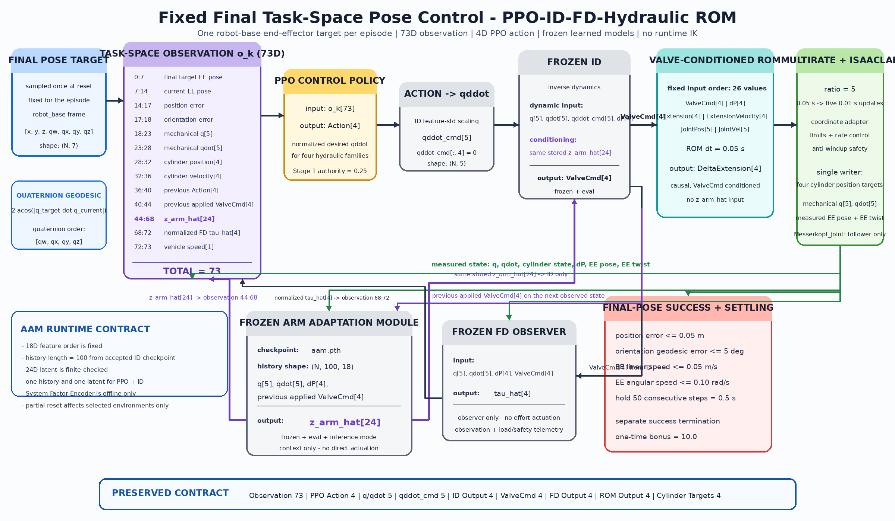

# Kevin Mulag Fixed Final-Pose Control

This directory contains the canonical Kevin Mulag workflow:

```text
fixed robot-base EE target
-> 73D task-space observation
-> PPO Action[4]
-> qddot_cmd[5], qddot_cmd[:, 4] = 0
-> frozen ID conditioned by z_arm_hat[24]
-> ValveCmd[4]
-> frozen FD observer + valve-conditioned hydraulic ROM
-> four cylinder position targets
-> IsaacLab Mulag mechanism
```



The active Gym task is:

```text
Kevin-Mulag-HydraulicROM-TaskSpace-v0
```

The final-pose target is sampled once for each selected environment at reset,
uses `[x, y, z, qw, qx, qy, qz]` in the `robot_base` frame, and remains fixed
for the episode. PPO is the task-space-to-action bridge; there is no runtime IK.
Strict success requires final pose accuracy, low end-effector linear/angular
speed, and 50 consecutive settled control steps.

## Environment

Run commands from the repository root:

```bash
cd /home/rrlab/rrlab_mulag
conda activate env_isaaclab
```

## Run The Simulation

### 1. Fixed final-pose PPO playback

Use an existing PPO checkpoint:

```bash
CHECKPOINT=/absolute/path/to/model_250.pt

./rrlab.sh -p kevin_integration/scripts/play_mulag_adaptive_rl.py \
  --task Kevin-Mulag-HydraulicROM-TaskSpace-v0 \
  --num_envs 1 \
  --checkpoint "$CHECKPOINT"
```

The local player imports `kevin_integration.tasks` after Isaac Sim startup and
before Hydra task resolution, verifies `gym.spec()`, and leaves the generic
IsaacLab `play.py` unchanged. Add `--headless` for non-visual playback.

On the current development machine, an example local checkpoint is
`kevin_integration/results/stage1_500env_13p9M_run/model_250.pt`. PPO `.pt`
artifacts are ignored by Git and are therefore not published with the source.

### 2. Deterministic checkpoint evaluation

```bash
./rrlab.sh -p kevin_integration/scripts/evaluate_mulag_checkpoints.py \
  --task Kevin-Mulag-HydraulicROM-TaskSpace-v0 \
  --run_dir /absolute/path/to/run \
  --num_envs 16 \
  --episodes 160 \
  --checkpoint_stride 10 \
  --headless
```

The evaluator writes `checkpoint_evaluation.json`,
`checkpoint_evaluation.csv`, and `best_checkpoint.json`. It ranks checkpoints
lexicographically by strict success rate, 50-step hold completion, mean maximum
hold duration, final pose/speed errors, avoidable clamp activity, and avoidable
valve saturation. Mean reward is recorded but cannot make a low-success
checkpoint win.

```bash
./rrlab.sh -p kevin_integration/scripts/play_mulag_adaptive_rl.py \
  --task Kevin-Mulag-HydraulicROM-TaskSpace-v0 \
  --num_envs 1 \
  --best_from_run /absolute/path/to/run
```

### 3. Runtime preflight only

This starts IsaacLab, runs the built-in asset and learned-pipeline motion
preflights, and exits before creating the PPO runner:

```bash
./rrlab.sh -p kevin_integration/scripts/train_mulag_adaptive_rl.py \
  --task Kevin-Mulag-HydraulicROM-TaskSpace-v0 \
  --num_envs 1 \
  --max_iterations 0 \
  --preflight_only \
  --headless
```

### 4. PPO training

Small validation run:

```bash
./rrlab.sh -p kevin_integration/scripts/train_mulag_adaptive_rl.py \
  --task Kevin-Mulag-HydraulicROM-TaskSpace-v0 \
  --num_envs 16 \
  --max_iterations 30 \
  --headless
```

Larger run after the one- and sixteen-environment gates pass:

```bash
./rrlab.sh -p kevin_integration/scripts/train_mulag_adaptive_rl.py \
  --task Kevin-Mulag-HydraulicROM-TaskSpace-v0 \
  --num_envs 600 \
  --max_iterations 100 \
  --headless
```

Use 2,000 environments only after the smaller runs are stable:

```bash
./rrlab.sh -p kevin_integration/scripts/train_mulag_adaptive_rl.py \
  --task Kevin-Mulag-HydraulicROM-TaskSpace-v0 \
  --num_envs 2000 \
  --max_iterations 100 \
  --headless
```

Resume training from a checkpoint:

```bash
CHECKPOINT=/absolute/path/to/model_250.pt

./rrlab.sh -p kevin_integration/scripts/train_mulag_adaptive_rl.py \
  --task Kevin-Mulag-HydraulicROM-TaskSpace-v0 \
  --num_envs 600 \
  --max_iterations 100 \
  --checkpoint "$CHECKPOINT" \
  --headless
```

## Online AAM Branch

The Arm Adaptation Module is active online and remains frozen:

```text
q[5], qdot[5], dP[4], previous applied ValveCmd[4]
-> one AAM history with shape (N, 100, 18)
-> frozen aam.pth under inference mode
-> z_arm_hat[24]
   |-> PPO observation indices 41:65
   `-> matching ID conditioning input
```

`_prev_valve_cmd` is copied from the ValveCmd supplied to FD and ROM during the
preceding control step. The same stored latent is used by PPO and ID. AAM does
not directly write valves, torques, ROM state, cylinder targets, rewards,
targets, or success state. The System Factor Encoder is offline-only.

## 70D Observation

```text
0:4    final target EE orientation quaternion
4:11   current EE pose
11:14  position error
14:15  quaternion-geodesic orientation error
15:20  mechanical q[5]
20:25  mechanical qdot[5]
25:29  cylinder position[4]
29:33  cylinder velocity[4]
33:37  previous Action[4]
37:41  previous applied ValveCmd[4]
41:65  z_arm_hat[24]
65:69  normalized FD observer output[4]
69:70  vehicle speed[1]
```

## Active Hydraulic ROM

Only the deployed valve-conditioned causal ROM is command-authoritative:

```text
kevin_integration/rom_cylinders/exported_valve_conditioned_causal_rom/
```

Runtime dependencies:

- `valve_conditioned_causal_rom.py`
- `multirate_rom_wrapper.py`
- `cylinder_coordinate_adapter.py`
- `cylinder_coordinate_mapping.json`
- `rom_data_contract.py`

The ROM consumes the fixed 26-feature order:

```text
ValveCmd[4], dP[4], Extension[4], ExtensionVelocity[4],
JointPos[5], JointVel[5]
```

It predicts `DeltaExtension[4]` over `0.05 s`. The multirate wrapper distributes
that prediction over five `0.01 s` Isaac control steps. The coordinate adapter
maps Simscape extension deltas to four Isaac prismatic position targets. FD is
observer-only and does not write actuator effort in this workflow.

## Reward Contract And Runtime Gates

The current reward contract is `task_space_reward_balance_v2`. It keeps the
strict success definition unchanged and adds potential-based pose progress,
bounded avoidable outward clamp penalties, soft applied-ValveCmd saturation
penalties, FD load excess above its normalized threshold, near-pose speed
penalties, settling reward, and monotonic hold-progress reward.

Key telemetry:

```text
reward_balance/positive_total_mean
reward_balance/negative_total_abs_mean
reward_balance/negative_to_positive_ratio
reward_balance/tracking_fraction
reward_balance/actuator_penalty_fraction
reward_balance/settling_fraction
rolling_1000/success_rate
rolling_1000/final_position_error
rolling_1000/final_orientation_error
rolling_1000/max_hold_steps
```

Changing the reward or environment contract requires fresh PPO training unless
an explicit checkpoint migration is documented. Runtime gates are registration,
one-environment visualization, deterministic checkpoint evaluation,
16-environment reward smoke test, 800-environment trend test, and finally
2000-environment scaling. Static tests do not prove Isaac runtime success.

## Current Source Layout

```text
scripts/
  train_mulag_adaptive_rl.py
  play_mulag_adaptive_rl.py

tasks/
  registered environment, configuration, task/reference helpers, contract tests

rl/
  AAM/ID/FD controller, observation/action adapters, rewards, torque conversion

controllers/
  learned checkpoint loaders and the imported reduced-ROM compatibility class

rom_cylinders/
  deployed valve-conditioned ROM, export package, mapping, multirate wrapper,
  data contract, and focused tests

models/
  aam.pth, id.pth, fd.pth, fd_scaler.pth, sd.pth

utils/
  Isaac simulation memory configuration
```

The reduced hydraulic actuator class remains because the environment imports
and initializes it for the retained compatibility path. It is not the active
command-authoritative ROM in the canonical task.

## Fixed Final-Pose Contract

The canonical experiment keeps:

- automatic curriculum advancement disabled;
- Stage 1 action authority `0.25`;
- episode duration `15 s`;
- position tolerance `0.05 m`;
- orientation tolerance `0.0872664626 rad`;
- EE linear speed tolerance `0.05 m/s`;
- EE angular speed tolerance `0.10 rad/s`;
- success hold of 50 consecutive `0.01 s` steps;
- separate success termination and one-time bonus `10.0`.

## Offline Verification

These commands do not start IsaacLab:


```bash
python kevin_integration/tasks/test_aam_runtime_wiring_contract.py
python kevin_integration/tasks/test_fixed_final_pose_task.py
python kevin_integration/tasks/test_preflight_observation_contract.py
python kevin_integration/tasks/test_asset_preflight_classifier.py
python kevin_integration/tasks/test_mechanical_constraint_resolver.py
python kevin_integration/tasks/test_rrlab_reference_conventions.py
python kevin_integration/tasks/test_task_space_reference.py
python kevin_integration/tasks/test_fd_observer_contract.py
python kevin_integration/rom_cylinders/test_valve_conditioned_runtime.py
python kevin_integration/rom_cylinders/test_multirate_rom_wrapper.py
python kevin_integration/rom_cylinders/test_cylinder_coordinate_adapter.py
```

Offline tests verify source and tensor contracts. They do not prove live Isaac
motion, GPU scaling, or training quality. Run the preflight and simulation
commands above before claiming runtime success.

## More Detail

- [Active file map](ACTIVE_PIPELINE_FILES.md)
- [IsaacLab control contract](ISAACLAB_CONTROL_CONTRACT.md)
- [Full hydraulic pipeline](FULL_HYDRAULIC_PIPELINE.md)
- [ROM runtime contract](rom_cylinders/ROM_DATA_CONTRACT.md)
